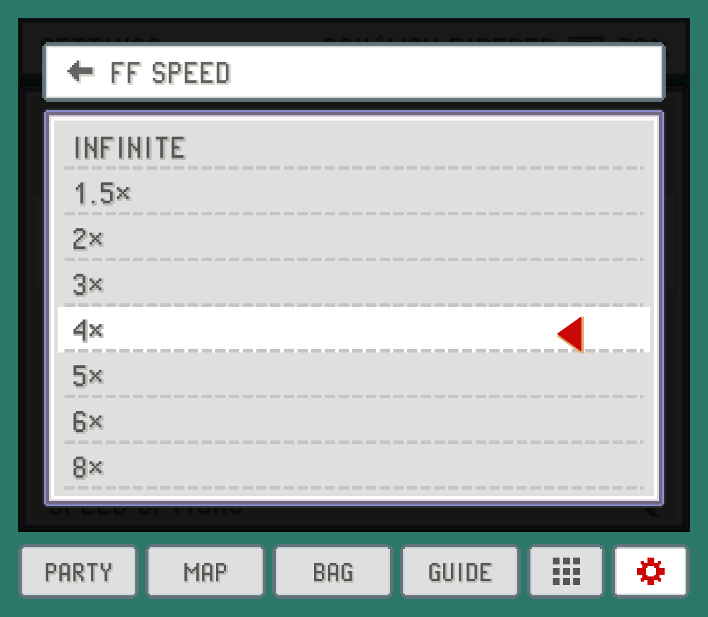

# The PokeDaisy manual

This folder is the user manual, and the only place it's written. The website turns it into
[pokedaisy.com/docs](https://pokedaisy.com/docs/) and the docs API (`/api/docs/v1/docs.json`),
and the app's HELP screens (top-screen Settings > HELP, the library's `?` button, the companion's
SETTINGS > HELP) read that API, keeping a copy for offline reading. Edit a page here and both readers show
it after the next release (the site, and with it the API, deploys only with an app release).

```
docs/manual/
  sections.yml     the sections, in reading order
  synonyms.yml     search: words people type -> words the pages use
  *.md             one page each (this README isn't one)
  shots/*.png      screenshots, rendered by ui-preview (never by hand)
  art/             the invented creatures and island map the screenshots use
```

## When to update it

**Every change a player can notice updates the manual in the same pull request**: a new feature, setting,
tab, button or supported game, a changed default, a renamed label, a removed option. If you're not sure
whether it counts, it counts. The checks below catch some of it (a setting no page mentions), not all.

## Writing

Write like a person who uses the app explaining it to a friend:

- **Second person, plain words, short paragraphs.** "Tap a Pokémon to open its summary", not "Users may
  access the summary view". Contractions are fine.
- **Say what it's for, then how.** Lead with the reason someone would want a feature.
- **Be concrete.** Name the exact screen and the exact label: `FF SPEED` in the companion's SETTINGS.
- **No dashes as punctuation.** No em dashes and no en dashes, and no spaced hyphen standing in for one.
  Use a comma, a colon, parentheses or a new sentence. Ranges are written out: "0.25x to 4x". (The website's
  tests fail on them.)
- **No filler.** Skip "seamlessly", "robust", "powerful", "simply", "just", "leverage", "unlock", "dive in".
- **No real Pokémon, move or item names**, in the text or the screenshots (the site's rule). Use the
  invented creatures from the screenshots (EMBERPUP, GALEFINCH, VOLTMOUSE, PEBBLON, SPROUTLING, THORNLET,
  BUBBLEFIN, WISPLET, MOTHWICK, CRAGMAW) or say "a Pokémon", "a move", "an item". Game titles (FireRed,
  Emerald, the hacks' names) and type names are fine.
- **Labels as the app shows them**, in `code`: `BACK`, `FF MODE`, `SMART`. Headings in sentence case.

## Page format

```markdown
---
title: Fast-forward and game speed
summary: One sentence that says what the page answers. Shown under the title and in search results.
section: player            # an id from sections.yml
order: 1                   # position in its section
keywords: [ff, turbo]      # words people search for that the page doesn't use
---

Opening paragraph.

## A section            (## and ### only; the title is the front matter's)

Text with **bold**, *italic*, `A LABEL` and [a link](other-page.md#a-heading).



> [!TIP]
> Callouts: [!TIP], [!NOTE] or [!WARNING].

| Setting | What it does |
| --- | --- |
| `FF SPEED` | ... |
```

That's the whole format: no HTML, no other blocks. The app draws every page natively, so anything else
fails the website build (`website/src/lib/docs.js` says which line). Links between pages use the file name
(`library.md#hidden-games`), and broken links or anchors fail the build too.

## Screenshots

Screenshots come from ui-preview's docs render: the app's real screens with an invented save (no game's
names or art). To add one, add a `Shot` to `ui-preview/src/render/DocsShots.kt`, then:

```sh
cd website && npm run docs-art && npm run build   # creature icons + map; the API the HELP shots read
cd ../ui-preview && gradle docsShots               # all of them, or -Ponly=companion-party
```

They land in `shots/` under the shot's name. Look at every one before you reference it.

## Checking your work

```sh
cd website && npm test && npm run build && npm run dev   # then open http://localhost:4321/docs/
```

`npm test` checks the pages parse, links resolve, screenshots exist, no dashes slipped in, every setting
label in the app is mentioned somewhere (`test/docs.test.js`), and that search finds what it should
(`test/docsearch-cases.json`, which the app's `DocsSearchTest` runs too).
