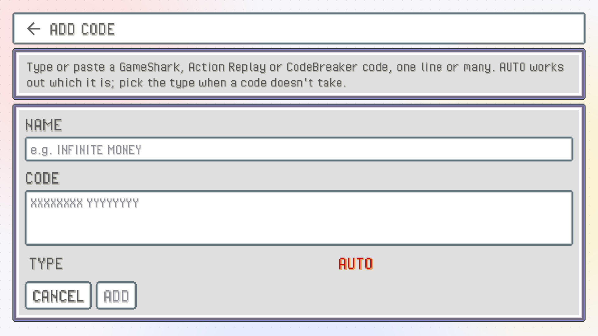
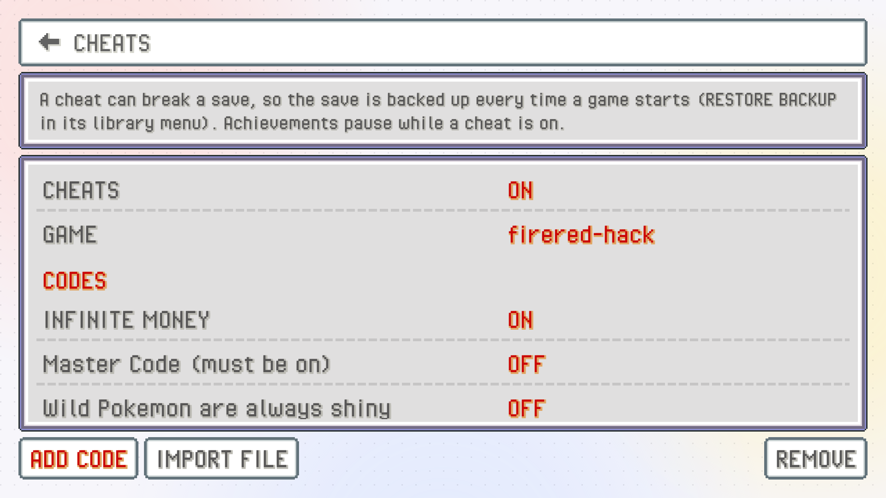

Cheat codes let you skip a grind, try something the game normally won't allow, or get past a bug in a hack. PokeDaisy reads the classic GBA cheat devices: **GameShark**, **Action Replay** and **CodeBreaker**. They work on GBA games only, not on Game Boy games.

Cheats are off until you turn them on. You add codes on the top screen (that's where the keyboard is), and switch them on and off from either screen, live, while the game runs.

## Turn cheats on

There's one master switch, `CHEATS`, and it starts `OFF`. While it's off, no code reaches any game, even the ones you've ticked on.

You'll find it in two places:

- **Top screen:** Settings > `CHEATS`, in the `LIBRARY` group.
- **Companion:** `SETTINGS` > `CHEATS`, in the `GAMEPLAY` group. The row shows `OFF`, or how many of this game's cheats are on (for example `2 ON`).

## Add a code

1. On the top screen, open Settings > `CHEATS`, or long-press a game in the library and pick `CHEATS` from its menu.
2. Check the `GAME` row says the right game. It starts on the game you played last; tap it to pick another from your library.
3. Tap `ADD CODE`.
4. Give it a `NAME` you'll recognise later (for example "MONEY 999999").
5. Type or paste the `CODE`. One line or many is fine, with or without spaces.
6. Leave `TYPE` on `AUTO`, which works out what kind of code it is. If a code doesn't take, set it to `GAMESHARK`, `ACTION REPLAY` or `CODEBREAKER` yourself.
7. Tap `ADD`.

A code you type in starts switched on, so it's ready the next time the game runs (as long as the master switch is on).

> [!NOTE]
> GameShark codes cover Action Replay v1 and v2 as well (they use the same format). Pick `ACTION REPLAY` for Action Replay v3 codes.

## Import a cheat file

If you have cheat files from another emulator, there's no need to type anything. On the same page, tap `IMPORT FILE` and pick:

- a RetroArch `.cht` file, or
- an mGBA `.cheats` file.

PokeDaisy tells you how many cheats came in. Imported cheats start switched off, since a file often holds dozens you won't want all at once. Tap the ones you want to turn them on.

## Bad lines are reported

Every line of a code is checked before it's kept. If a line can't be read, PokeDaisy says which one instead of quietly skipping it:

- When you add a code by hand, it isn't added, and you see the line that's wrong. Fix the typo, or try a different `TYPE`.
- When you import a file, the good cheats come in and you're told how many were left out.

## Switch cheats on and off while you play

You don't have to leave the game. On the companion, open `SETTINGS` > `CHEATS`: the first row is the master switch, then there's one row per cheat for the game you're playing. Tap a row to flip it `ON` or `OFF`. The game picks up the change on the next frame.

If the list says `NO CHEATS FOR THIS GAME`, add some on the top screen first.

On the top screen's `CHEATS` page you can flip them the same way, and `REMOVE` lets you delete cheats you don't need any more (tap `DONE` when you're finished).

## Cheats belong to one game

Each game has its own list, tied to that exact ROM. Codes for one game never load in another, not even a different version of the same game (codes rarely work across versions anyway).

Your cheats stay with the game if you rename the file or zip it. They're kept separately from your saves, so copying a save around won't take them along, and they're never part of a save backup.

## Turning cheats off undoes them

When you turn a cheat off (or flip the master switch), PokeDaisy takes it out completely. Codes that patch the game itself are reversed, so with no cheats on, the game runs exactly as it would without them.

What a cheat already changed in your game stays changed, though. If a code gave you 999 of an item and you saved, you still have them. Save states also keep whatever a cheat wrote into memory, but they don't keep the cheats themselves.

> [!WARNING]
> A cheat can break a save, especially the ones that change items, Pokémon or story flags. PokeDaisy copies your save every time a game starts, so you can go back with `RESTORE BACKUP` in the game's library menu. See [Saves](saves.md).

## Cheats and RetroAchievements

While any cheat is loaded, achievements pause: nothing is checked and nothing unlocks. In a game with an achievement set you see a `CHEATS ON` notice when this happens, and the achievements tab is marked as paused. Turn every cheat off (or the master switch) and they carry on, with a `CHEATS OFF` notice. See [Achievements](achievements.md).
